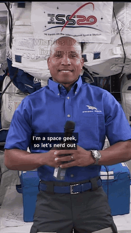

# talk2shorts

[English](../README.md) · [한국어](README.ko.md) · [日本語](README.ja.md) · [中文](README.zh.md) · [Português](README.pt.md) · [हिन्दी](README.hi.md) · **Bahasa Indonesia** · [Français](README.fr.md) · [Русский](README.ru.md)

Ubah satu bagian dari talk, kuliah, atau wawancara berformat horizontal menjadi video pendek vertikal, cukup dengan satu perintah. Crop mengikuti pembicara, caption dibuat dari ucapan dan ditempatkan di area yang **tidak akan tertutup tombol YouTube Shorts, TikTok, dan Instagram Reels**, dan suara diatur ke -14 LUFS.

<p align="center">
  
</p>


```
talk2shorts interview.mp4 --start 0:10 --end 0:50 --title "What it's like to live in space"
```

## Apa yang dilakukannya

1. **Mengikuti wajah.** Detektor YuNet dari OpenCV mencari pembicara lima kali per detik; crop 9:16 mengikuti gerakan besar dan mengabaikan gerakan kecil, jadi gambar tidak ikut bergoyang setiap kali pembicara bergerak.
2. **Menulis caption.** [faster-whisper](https://github.com/SYSTRAN/faster-whisper) mentranskripsi bagian tersebut lengkap dengan waktu tiap kata, lalu talk2shorts mengelompokkan kata-kata menjadi caption berisi paling banyak dua baris yang seimbang, dipotong di jeda, akhir kalimat, dan koma, tanpa pernah menyisakan satu kata sendirian. Atau pakai file SRT milik Anda sendiri.
3. **Menjauhkan teks dari tombol pemutar.** Caption dan judul ditempatkan di dalam area yang bebas di ketiga platform, berdasarkan zona yang diukur dari template resmi masing-masing platform di [shorts-safezone](https://github.com/CokeRoach/shorts-safezone). Di TikTok, area itu sempit di bagian bawah (tombolnya ada di sisi kanan), sehingga caption sedikit bergeser ke kiri dari tengah; tambahkan `--platforms youtube` untuk memakai area YouTube yang lebih lebar saja.
4. **Mengatur suara.** Normalisasi loudness dua tahap ke -14 LUFS, true peak di bawah -1.5 dB, dengan fade di akhir.
5. **Memeriksa hasil.** Sebuah laporan menyebutkan apakah setiap caption dan judul bebas dari tombol di tiap platform, loudness yang terukur, seberapa sering wajah terdeteksi, dan apakah judul menutupi wajah.

Semuanya berjalan di komputer Anda. Tidak ada yang diunggah.

## Instalasi

Anda memerlukan [ffmpeg](https://ffmpeg.org) di PATH (dengan libass, seperti pada kebanyakan build), lalu:

```
pip install "talk2shorts[captions]"
```

Hilangkan `[captions]` jika Anda selalu memberikan `--srt` sendiri. Model wajah (230 KB, lisensi MIT) diunduh sekali saat pertama kali dipakai dan diperiksa dengan SHA-256-nya.

## Penggunaan

```
talk2shorts talk.mp4 --start 3:33 --end 4:25
talk2shorts talk.mp4 --start 213 --end 265 --title "Where does happiness come from?" --language en
talk2shorts talk.mp4 --start 3:33 --end 4:25 --srt talk.srt          # your captions, in source time
talk2shorts talk.mp4 --start 3:33 --end 4:25 --model large-v3        # better captions, slower
talk2shorts talk.mp4 --start 3:33 --end 4:25 --platforms youtube     # only YouTube's buttons
```

Perintah ini menghasilkan `talk_short.mp4`, caption dalam bentuk `talk_short.srt`, dan `talk_short.report.json`:

```json
{
  "face_found_share": 1.0,
  "captions": 22,
  "caption_safe": { "youtube": [], "tiktok": [], "reels": [] },
  "title_safe":   { "youtube": [], "tiktok": [], "reels": [] },
  "title_covers_face": true,
  "loudness": { "source": -23.05, "output": -14.05 }
}
```

Daftar kosong berarti teks bebas dari tombol di platform tersebut. Perintah keluar dengan kode 1 jika ada teks yang tertutup, sehingga bisa dipakai sebagai pengaman dalam skrip batch.

| Opsi | Bawaan | |
| --- | --- | --- |
| `--title` | tidak ada | Ditampilkan di bagian atas selama 3 detik pertama; `\n` untuk pindah baris |
| `--srt` | pengenalan ucapan | Caption milik Anda sendiri, dengan waktu sesuai video sumber |
| `--model` | `small` | Model faster-whisper: `tiny`, `base`, `small`, `medium`, `large-v3` |
| `--language` | terdeteksi otomatis | Kode bahasa yang diucapkan, misalnya `en`, `ko`, `ja` |
| `--lines` | `2` | Jumlah baris per caption, 1 atau 2 |
| `--platforms` | `all` | `youtube`, `tiktok`, `reels`, atau daftar yang dipisah koma |
| `--font` | font sistem tebal yang sesuai dengan aksaranya | File font untuk caption dan judul |
| `--no-track` | nonaktif | Biarkan crop tetap di tengah |
| `--no-captions` | nonaktif | Tanpa caption |

GPU mempercepat pengenalan ucapan jika library CUDA untuk faster-whisper sudah terpasang; tanpa library itu, talk2shorts otomatis beralih ke CPU.

## Bahasa

Pengenalan ucapan mencakup bahasa-bahasa yang dikenali faster-whisper (sekitar 99). Font caption mengikuti aksara yang sedang ditulis, sehingga setiap bahasa mendapat font tebal yang memiliki huruf-hurufnya:

| Aksara | Windows | macOS | Linux |
| --- | --- | --- | --- |
| Korea | Malgun Gothic | Apple SD Gothic Neo | Noto Sans CJK |
| Jepang | Yu Gothic | Hiragino Sans | Noto Sans CJK |
| Tionghoa | Microsoft YaHei | PingFang | Noto Sans CJK |
| Hindi (Dewanagari) | Nirmala UI | Kohinoor | Noto Sans Devanagari |
| Arab | Segoe UI | Geeza Pro | Noto Sans Arabic |
| Thai | Leelawadee UI | Thonburi | Noto Sans Thai |
| Latin, Sirilik | Segoe UI | Helvetica Neue | Noto Sans |

Teks yang hanya berisi karakter Han dibaca sebagai bahasa Tionghoa; tambahkan `--language ja` untuk bahasa Jepang yang ditulis tanpa kana. Bahasa Arab ditata dari kanan ke kiri. Caption dipotong setelah akhir kalimat dan koma (termasuk 、 dan ，), tidak pernah memulai baris dengan tanda baca penutup, dan menjaga tanda vokal Thai dan Dewanagari tetap menempel pada hurufnya. Gunakan `--font` untuk memilih font Anda sendiri.

## Batasan

- Hasil terbaik didapat jika hanya ada satu pembicara dalam frame. Jika ada dua orang berdampingan, crop mengikuti wajah yang lebih besar.
- Subtitle yang sudah tertanam di video sumber tetap terlihat di gambar.
- Jika kepala pembicara berada dekat bagian atas frame, judul bisa menutupinya; laporan akan menyebutkannya (`title_covers_face`). Judul yang lebih pendek dan hanya satu baris akan membantu.
- Bahasa Thai ditulis tanpa spasi antarkata, dan talk2shorts tidak memiliki kamus bahasa Thai, sehingga baris Thai yang panjang bisa terpotong di tengah kata.
- Pengenalan ucapan bisa keliru, terutama pada nama. Baca file `.srt`, perbaiki, lalu render ulang dengan `--srt`.

## Pengembangan

```
python -m venv .venv
.venv/Scripts/pip install -e ".[test,captions]"     # or .venv/bin/pip on macOS and Linux
.venv/Scripts/python -m pytest
```

## Kredit

- Rekaman demo: astronaut NASA Victor Glover dalam wawancara dari luar angkasa dengan KCAL-TV, 30 Desember 2020 ([NASA Image and Video Library](https://images.nasa.gov/details/iss064m263651519_Expedition_64_Inflight%20with_KCAL_LA_201230)). Materi NASA berada dalam domain publik; NASA tidak mendukung proyek ini.
- Deteksi wajah: [YuNet](https://github.com/opencv/opencv_zoo/tree/main/models/face_detection_yunet), lisensi MIT.
- Pengenalan ucapan: [faster-whisper](https://github.com/SYSTRAN/faster-whisper), lisensi MIT.

## Lisensi

MIT
