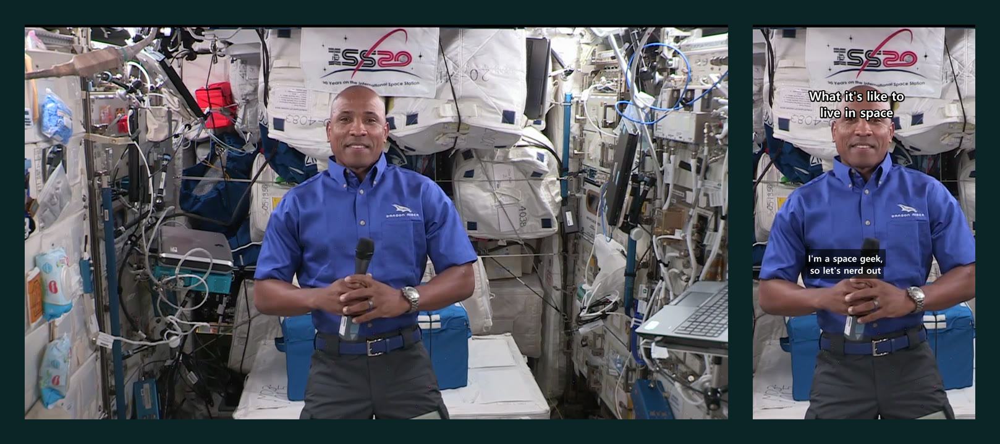

# talk2shorts

[English](../README.md) · [한국어](README.ko.md) · [日本語](README.ja.md) · [中文](README.zh.md) · **Português** · [हिन्दी](README.hi.md) · [Bahasa Indonesia](README.id.md) · [Français](README.fr.md) · [Русский](README.ru.md)

Transforme um trecho de uma palestra, aula ou entrevista em formato horizontal em um vídeo curto vertical, com um único comando. O enquadramento acompanha quem está falando, as legendas são geradas a partir da fala e posicionadas onde **os botões do YouTube Shorts, do TikTok e do Instagram Reels não vão cobri-las**, e o áudio é ajustado para -14 LUFS.

<p align="center">
  
</p>



```
talk2shorts interview.mp4 --start 0:10 --end 0:50 --title "What it's like to live in space"
```

## O que ele faz

1. **Acompanha o rosto.** O detector YuNet do OpenCV localiza quem está falando cinco vezes por segundo; o recorte 9:16 acompanha os movimentos maiores e ignora os pequenos, para não tremer a cada gesto.
2. **Gera as legendas.** O [faster-whisper](https://github.com/SYSTRAN/faster-whisper) transcreve o trecho com o tempo de cada palavra, e o talk2shorts agrupa as palavras em legendas de até duas linhas equilibradas, quebradas nas pausas, nos fins de frase e nas vírgulas, sem nunca deixar uma palavra sozinha. Ou use o seu próprio SRT.
3. **Mantém o texto longe da interface dos players.** As legendas e o título ficam dentro da área livre nas três plataformas, usando as zonas medidas a partir dos templates oficiais de cada plataforma no [shorts-safezone](https://github.com/CokeRoach/shorts-safezone). No TikTok essa área é estreita na parte de baixo (os botões ficam à direita), então as legendas ficam um pouco à esquerda do centro; passe `--platforms youtube` para usar apenas a área mais larga do YouTube.
4. **Ajusta o áudio.** Normalização de loudness em duas passadas para -14 LUFS, true peak abaixo de -1.5 dB, com fade no final.
5. **Confere o resultado.** Um relatório informa se cada legenda e o título estão livres em cada plataforma, a loudness medida, com que frequência um rosto foi encontrado e se o título cobre o rosto.

Tudo roda no seu computador. Nada é enviado para a internet.

## Instalação

Você precisa do [ffmpeg](https://ffmpeg.org) no seu PATH (com libass, como na maioria das builds) e, depois:

```
pip install "talk2shorts[captions]"
```

Deixe de fora o `[captions]` se você sempre for passar o seu próprio `--srt`. O modelo de rosto (230 KB, licença MIT) é baixado uma vez no primeiro uso e verificado pelo seu SHA-256.

## Uso

```
talk2shorts talk.mp4 --start 3:33 --end 4:25
talk2shorts talk.mp4 --start 213 --end 265 --title "Where does happiness come from?" --language en
talk2shorts talk.mp4 --start 3:33 --end 4:25 --srt talk.srt          # your captions, in source time
talk2shorts talk.mp4 --start 3:33 --end 4:25 --model large-v3        # better captions, slower
talk2shorts talk.mp4 --start 3:33 --end 4:25 --platforms youtube     # only YouTube's buttons
```

Ele gera `talk_short.mp4`, as legendas como `talk_short.srt` e `talk_short.report.json`:

```json
{
  "face_found_share": 1.0,
  "captions": 22,
  "caption_safe": { "youtube": [], "tiktok": [], "reels": [] },
  "title_safe":   { "youtube": [], "tiktok": [], "reels": [] },
  "title_covers_face": true,
  "loudness": { "source": -23.05, "output": -14.05 }
}
```

Uma lista vazia significa que está tudo livre naquela plataforma. O comando termina com código 1 quando algum texto fica coberto, então ele pode servir de verificação em um script de lote.

| Opção | Padrão | |
| --- | --- | --- |
| `--title` | nenhum | Exibido no topo nos primeiros 3 segundos; `\n` quebra a linha |
| `--srt` | reconhecimento de fala | Suas próprias legendas, sincronizadas com o vídeo original |
| `--model` | `small` | Modelo do faster-whisper: `tiny`, `base`, `small`, `medium`, `large-v3` |
| `--language` | detectado | Código do idioma falado, como `en`, `ko`, `ja` |
| `--lines` | `2` | Linhas por legenda, 1 ou 2 |
| `--platforms` | `all` | `youtube`, `tiktok`, `reels` ou uma lista separada por vírgulas |
| `--font` | uma fonte de sistema em negrito para a escrita | Um arquivo de fonte para as legendas e o título |
| `--no-track` | desativado | Mantém o recorte centralizado |
| `--no-captions` | desativado | Sem legendas |

Uma GPU acelera o reconhecimento de fala quando as bibliotecas CUDA do faster-whisper estão instaladas; sem elas, o talk2shorts volta para a CPU automaticamente.

## Idiomas

O reconhecimento de fala cobre os idiomas que o faster-whisper conhece (cerca de 99). A fonte das legendas acompanha a escrita usada, então cada idioma recebe uma fonte em negrito que tem as suas letras:

| Escrita | Windows | macOS | Linux |
| --- | --- | --- | --- |
| Coreano | Malgun Gothic | Apple SD Gothic Neo | Noto Sans CJK |
| Japonês | Yu Gothic | Hiragino Sans | Noto Sans CJK |
| Chinês | Microsoft YaHei | PingFang | Noto Sans CJK |
| Hindi (devanágari) | Nirmala UI | Kohinoor | Noto Sans Devanagari |
| Árabe | Segoe UI | Geeza Pro | Noto Sans Arabic |
| Tailandês | Leelawadee UI | Thonburi | Noto Sans Thai |
| Latim, cirílico | Segoe UI | Helvetica Neue | Noto Sans |

Texto só com caracteres han é lido como chinês; passe `--language ja` para japonês escrito sem kana. O árabe é diagramado da direita para a esquerda. As legendas quebram depois de fins de frase e vírgulas (、 e ，também), nunca começam uma linha com pontuação de fechamento e mantêm os sinais vocálicos do tailandês e do devanágari junto da sua letra. Use `--font` para escolher a sua própria fonte.

## Limitações

- Funciona melhor com uma única pessoa falando no quadro. Com duas pessoas lado a lado, o recorte acompanha o rosto maior.
- Legendas já gravadas no vídeo original continuam na imagem.
- Quando a cabeça de quem fala está perto do topo do quadro, o título pode cobri-la; o relatório avisa (`title_covers_face`). Um título mais curto, de uma linha só, ajuda.
- O tailandês é escrito sem espaços entre as palavras, e o talk2shorts não tem um dicionário de tailandês, então uma linha longa em tailandês pode quebrar no meio de uma palavra.
- O reconhecimento de fala comete erros, principalmente com nomes. Leia o `.srt` e renderize de novo com `--srt` depois de corrigi-lo.

## Desenvolvimento

```
python -m venv .venv
.venv/Scripts/pip install -e ".[test,captions]"     # or .venv/bin/pip on macOS and Linux
.venv/Scripts/python -m pytest
```

## Créditos

- Imagens da demonstração: o astronauta da NASA Victor Glover em uma entrevista em órbita à KCAL-TV, em 30 de dezembro de 2020 ([NASA Image and Video Library](https://images.nasa.gov/details/iss064m263651519_Expedition_64_Inflight%20with_KCAL_LA_201230)). O material da NASA é de domínio público; a NASA não endossa este projeto.
- Detecção de rosto: [YuNet](https://github.com/opencv/opencv_zoo/tree/main/models/face_detection_yunet), licença MIT.
- Reconhecimento de fala: [faster-whisper](https://github.com/SYSTRAN/faster-whisper), licença MIT.

## Licença

MIT
